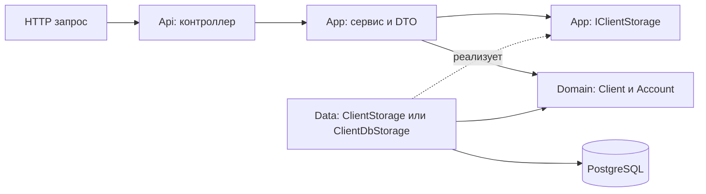

# Как разобраться в BankSystem и показать его на собеседовании

Проект доработан с помощью Codex. Этот документ помогает самостоятельно проверить понимание кода; он не подтверждает, что весь код написан без помощи. Если какой-то участок пока непонятен, лучше сказать об этом и показать знакомый сценарий.

## Восемь проектов

**BankSystem.Domain** содержит основные данные: `Person`, его наследников `Client` и `Employee`, банковский `Account` и валюту `Currency`. Счёт проверяет сумму пополнения и снятия и защищает баланс через `lock`. Модели не знают ни о HTTP, ни о PostgreSQL.

**BankSystem.App** описывает действия: создание и поиск клиентов, изменение сотрудников, списания и проценты. `IClientStorage` и `IEmployeeStorage` объясняют, какие операции нужны сервисам. DTO описывают запросы и ответы API. FluentValidation проверяет входящие запросы. Учебные примеры делегатов, событий и рефлексии находятся отдельно от основных сервисов.

**BankSystem.Data** реализует интерфейсы двумя способами: словарями в памяти и через EF Core. `BankSystemDbContext` явно подключает четыре конфигурации таблиц. Миграции описывают изменение схемы. В `ClientDbStorage` видно, где запрос выполняется и где вызывается `SaveChangesAsync`.

**BankSystem.Api** принимает HTTP-запросы. `Program.cs` регистрирует зависимости, а контроллеры вызывают сервисы и выбирают HTTP-коды. Контроллер не выполняет SQL.

**ExportTool** читает и записывает CSV/JSON. CsvHelper разбирает кавычки и переносы строк. JSON содержит и вложенные счета. Импорт CSV вызывает сервис, а не обращается к базе напрямую.

**Practice** — консольная программа: запустите её и сопоставьте каждую строку вывода с кодом. `PostgresSmoke` — дополнительная проверка исключительно собственной учебной базы.

**BankSystem.App.Tests** содержит NUnit-тесты. Часть проверяет отдельные методы, часть — реляционное хранение SQLite и настоящий локальный HTTP-сервер.

**ConsoleApp4** — сохранённый исходный консольный пример, он не участвует в работе банковского API.

## Как связаны слои

Сервис использует интерфейс. `Program.cs` решает, какую реализацию передать: память без строки подключения или EF Core с подключением. Ссылка проектов идёт Data→App→Domain; App не ссылается на Data. Вызов во время работы направлен от сервиса к объекту хранилища через интерфейс.

## Путь создания клиента

1. Браузер отправляет JSON в `POST /api/clients`.
2. ASP.NET создаёт `ClientRequest`. Ошибка JSON или обязательных полей даёт 400.
3. `ClientsController.Create` вызывает `ClientService.CreateAsync`.
4. FluentValidation проверяет запрос. `ToModel` создаёт `Client`.
5. `AddClientAsync` проверяет бизнес-правила и добавляет USD-счёт, если счетов ещё нет.
6. Сервис вызывает `_storage.AddAsync`. Для памяти объект попадает в словарь; для PostgreSQL EF добавляет клиента/счёт и выполняет `SaveChangesAsync`.
7. `ToResponse` формирует DTO ответа. Контроллер возвращает 201 и `Location` для GET нового клиента.

Поставьте breakpoint в `ClientService.CreateAsync` и пройдите шаги сами. Автоматическая проверка Rider уже останавливала реальный запрос в контроллере и показывала DTO/стек, но понимание процесса нужно проверить самостоятельно.

## Главные участки для чтения

| Файл / тип | Что нужно уметь объяснить |
|---|---|
| Domain/Models.cs | Наследование Person, равенство по Id, баланс Account и lock |
| App/ClientService.cs | Валидация до изменений, USD-счёт, поиск, операции со счетами |
| App/EmployeeService.cs | Повторение сервисного подхода для сотрудников |
| App/Abstractions.cs | Что обещает интерфейс хранилища и зачем нужен T |
| Data/Storages.cs | Словарь, поиск по Id, блокировка; почему нет Task.Run |
| Data/ClientDbStorage.cs | Include, Where, AsNoTracking, SaveChangesAsync, пагинация |
| Data/BankSystemDbContext.cs | DbSet и четыре явные конфигурации таблиц |
| Api/Program.cs, Controllers.cs | DI, маршруты, DTO и HTTP-коды |
| ExportTool/ExportService.cs | using, CsvHelper, generic JSON и вложенные счета |
| App/RateUpdaterService.cs | Отмена и ожидание следующего месяца |

## Где используются технологии курса

- **ООП:** Person/Client/Employee; Animal/Dog/Cat показывают virtual dispatch. Account скрывает прямую запись баланса.
- **LINQ:** Where/OrderBy/Skip/Take в DB-хранилище, Count/MinBy в примерах. В базе выражение переводится в SQL, а в памяти фильтр компилируется в функцию C#.
- **DI:** обычный конструктор сервиса принимает интерфейс. Регистрация находится в Program.cs. Scoped DbContext живёт в рамках запроса.
- **async/await:** ожидание БД, файлов и HTTP. Оно не обещает отдельный поток. В памяти нечего ожидать — возвращается завершённый Task.
- **EF Core:** модели сопоставлены таблицам, связи заданы внешними ключами, миграции изменяют схему. Поле Amount проверяется при конкурентном обновлении.
- **События:** ObservableBalance и ThresholdQueue уведомляют подписчиков. В Practice видны подписка и отписка.
- **Обобщения:** IStorage<T>, generic JSON, бонус/чёрный список для наследников Person. Дополнительных generic-репозиториев нет.

SafeHandle и ручные часы в тестах сложнее основной логики. SafeHandle нужен для надёжного освобождения выделенной памяти, а тестовые часы — чтобы проверить месяц без реального ожидания. Не нужно выдавать эти вспомогательные механизмы за собственное уверенное знание, если вы их ещё не разобрали.

## 20 вопросов интервьюера

1. **Зачем четыре основных слоя?** Чтобы модели, действия, хранение и HTTP можно было читать и менять отдельно.
2. **Почему сервис зависит от IClientStorage?** Один сценарий работает и со словарём, и с базой; хранилище выбирает DI.
3. **Чем Client отличается от ClientRequest?** Client — модель приложения, ClientRequest — поля входящего HTTP-запроса.
4. **Где появляется USD-счёт?** В подготовке клиента перед добавлением; DB storage также поддерживает прямое учебное добавление.
5. **Почему не меняем старый объект сразу в PUT?** Иначе ошибочный запрос мог бы уже испортить данные в памяти.
6. **Чем class отличается от struct при передаче в метод?** Копируется ссылка либо значение; ref позволяет изменить переменную вызывающего кода.
7. **Почему Client нельзя просто привести к Employee?** Это разные наследники Person; требуется создание сотрудника и копирование полей.
8. **Почему Equals и GetHashCode используют Id?** Так новый объект с тем же Id находится как равный ключ словаря.
9. **Почему Dictionary быстрее LINQ-поиска?** Поиск по ключу обычно O(1), последовательный просмотр — O(n).
10. **Когда выполняется запрос EF?** При ToList/Count/Single и их async-вариантах; до этого строится запрос.
11. **Для чего AsNoTracking?** Для чтения без автоматического отслеживания изменений; сохранение такого объекта нужно организовать явно.
12. **Что делает Include?** Загружает связанные счета и валюты вместе с клиентом.
13. **Как добавить столбец в БД?** Изменить модель/конфигурацию, создать и проверить миграцию, применить её к своей учебной базе.
14. **Почему нельзя использовать один DbContext параллельно?** Он не предназначен для одновременных операций. В списаниях одного storage используется SemaphoreSlim.
15. **Зачем lock, если есть async?** Несколько потоков всё равно могут менять общий баланс; async не делает данные потокобезопасными.
16. **Что даёт CancellationToken?** Позволяет операции согласованно прекратиться. Уже завершённые изменения не откатываются автоматически.
17. **Какие HTTP-коды возвращает API?** 201 — создано, 200 — данные, 204 — изменение/удаление, 400 — неверный запрос, 404 — нет записи, 409 — конфликт обновления.
18. **Почему нужен using при экспорте?** Он освобождает файл и сбрасывает буферы даже при исключении.
19. **Что проверяет SQLite, а что PostgreSQL?** SQLite быстро проверяет реляционную логику; настоящий PostgreSQL проверяет свой SQL, provider и миграции.
20. **Что пока ограничивает проект?** Нет полноценной авторизации, банковского журнала/общих транзакций; live DEX требует безопасного endpoint и учётки. Это учебная демонстрация.

Попробуйте сначала ответить вслух без текста. После этого измените одно правило, например минимальный возраст, добавьте тест и проследите результат через API.

## Объяснение архитектуры за две минуты

«BankSystem — мой учебный проект для практики C# и .NET. Я разбираю его и дорабатываю с помощью Codex. Основные сущности — клиент, сотрудник, счёт и валюта. Domain хранит модели и правила баланса. App содержит сценарии, валидацию и интерфейсы хранилищ. Data реализует хранение в словаре и в PostgreSQL через EF Core. API принимает JSON и вызывает сервисы.

Например, POST клиента попадает в контроллер, затем в ClientService. Проверяются данные, создаётся клиент и стандартный USD-счёт. Хранилище сохраняет их, а API возвращает 201 с идентификатором. Какое хранилище используется, задаёт DI.

В проекте есть LINQ-фильтры и пагинация, CSV/JSON экспорт, async операции, отмена и защита общего баланса. NUnit проверяет отдельные правила и реальные HTTP-запросы. PostgreSQL отдельно проверен во временном кластере, включая откат миграции с сохранением данных. Я могу показать создание клиента, ошибку валидации, поиск и тесты. При этом это учебный проект, а не промышленная банковская система».
